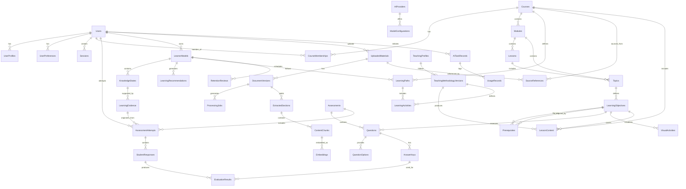

# DATABASE_DESIGN.md

# AQVERA — Database Design

## Design Principles (DECIDED)

- Relational model (PostgreSQL) as the source of truth for academic data.
- Normalize where appropriate; avoid duplicated representations without a clear reason.
- pgvector for vector search (content chunks, embeddings) — keeps search within PostgreSQL.
- Soft deletion where appropriate; never silently rewrite historical assessment results.
- Learning evidence records are immutable; corrections are new records.
- Explicit primary keys, foreign keys, unique constraints, and indexing strategy.
- Transactions define write boundaries; long-running jobs use idempotency keys.

## Entity Relationship Diagram (Mermaid)

## Entity Definitions

### Identity

**Users** (authoritative)
- id: UUID (PK)
- email: VARCHAR(255) UNIQUE NOT NULL
- password_hash: VARCHAR(255) NOT NULL
- created_at: TIMESTAMP NOT NULL
- updated_at: TIMESTAMP NOT NULL
- is_active: BOOLEAN DEFAULT true
- deleted_at: TIMESTAMP NULL (soft delete)

**UserProfiles**
- id: UUID (PK)
- user_id: UUID (FK → Users.id, UNIQUE)
- display_name: VARCHAR(255)
- avatar_url: VARCHAR(512)
- created_at, updated_at

**UserPreferences**
- id: UUID (PK)
- user_id: UUID (FK → Users.id, UNIQUE)
- theme: VARCHAR(32) DEFAULT 'system'
- language: VARCHAR(8) DEFAULT 'en'
- study_time_per_day_minutes: INTEGER
- notification_settings: JSONB
- created_at, updated_at

**Sessions**
- id: UUID (PK)
- user_id: UUID (FK → Users.id)
- token_hash: VARCHAR(255) NOT NULL (hashed refresh token)
- expires_at: TIMESTAMP NOT NULL
- created_at: TIMESTAMP NOT NULL
- last_accessed_at: TIMESTAMP
- revoked_at: TIMESTAMP NULL

### Academic Structure

**Courses**
- id: UUID (PK)
- owner_id: UUID (FK → Users.id)
- title: VARCHAR(255) NOT NULL
- description: TEXT
- status: VARCHAR(32) DEFAULT 'draft' (draft, published, archived)
- difficulty_level: VARCHAR(32)
- estimated_hours: INTEGER
- teaching_profile_id: UUID (FK → TeachingProfiles.id)
- methodology_version_id: UUID (FK → TeachingMethodologyVersions.id)
- created_at, updated_at, deleted_at (soft)

**CourseMemberships**
- id: UUID (PK)
- course_id: UUID (FK → Courses.id)
- user_id: UUID (FK → Users.id)
- role: VARCHAR(32) DEFAULT 'student' (student, instructor)
- enrolled_at: TIMESTAMP NOT NULL
- UNIQUE(course_id, user_id)

**Modules**
- id: UUID (PK)
- course_id: UUID (FK → Courses.id)
- title: VARCHAR(255) NOT NULL
- description: TEXT
- order_index: INTEGER NOT NULL
- prerequisites: JSONB (module IDs)
- created_at, updated_at

**Lessons**
- id: UUID (PK)
- module_id: UUID (FK → Modules.id)
- title: VARCHAR(255) NOT NULL
- content_type: VARCHAR(32)
- order_index: INTEGER NOT NULL
- created_at, updated_at

**Topics**
- id: UUID (PK)
- lesson_id: UUID (FK → Lessons.id) — nullable (topic can belong to module directly)
- module_id: UUID (FK → Modules.id)
- title: VARCHAR(255) NOT NULL
- description: TEXT
- order_index: INTEGER NOT NULL
- created_at, updated_at

**LearningObjectives**
- id: UUID (PK)
- topic_id: UUID (FK → Topics.id)
- title: VARCHAR(255) NOT NULL
- description: TEXT
- bloom_level: VARCHAR(32) (remember, understand, apply, analyze, evaluate, create)
- difficulty: VARCHAR(32)
- estimated_minutes: INTEGER
- created_at, updated_at

**Prerequisites**
- id: UUID (PK)
- objective_id: UUID (FK → LearningObjectives.id)
- prerequisite_objective_id: UUID (FK → LearningObjectives.id)
- relationship_type: VARCHAR(32) (required, recommended)
- UNIQUE(objective_id, prerequisite_objective_id)

### Content

**UploadedMaterials**
- id: UUID (PK)
- user_id: UUID (FK → Users.id)
- original_filename: VARCHAR(512) NOT NULL
- stored_filename: VARCHAR(512) NOT NULL
- storage_path: VARCHAR(1024) NOT NULL
- content_type: VARCHAR(128) NOT NULL
- file_size_bytes: BIGINT NOT NULL
- sha256: VARCHAR(64) NOT NULL (integrity)
- status: VARCHAR(32) DEFAULT 'uploaded' (uploaded, processing, completed, failed)
- created_at, updated_at, deleted_at (soft)

**DocumentVersions**
- id: UUID (PK)
- material_id: UUID (FK → UploadedMaterials.id)
- version_number: INTEGER NOT NULL
- extraction_status: VARCHAR(32)
- extracted_text: TEXT (or reference to external store)
- created_at

**ProcessingJobs**
- id: UUID (PK)
- material_id: UUID (FK → UploadedMaterials.id)
- job_type: VARCHAR(32) (extraction, ocr, chunking, embedding, course_generation)
- status: VARCHAR(32) DEFAULT 'pending' (pending, in_progress, completed, failed, cancelled)
- progress: INTEGER DEFAULT 0 (0-100)
- failure_reason: TEXT
- retry_count: INTEGER DEFAULT 0
- max_retries: INTEGER DEFAULT 3
- idempotency_key: VARCHAR(255) UNIQUE
- created_at, started_at, completed_at

**ExtractedSections**
- id: UUID (PK)
- document_version_id: UUID (FK → DocumentVersions.id)
- section_title: VARCHAR(255)
- section_type: VARCHAR(32) (heading, paragraph, table, figure, equation)
- content: TEXT
- page_number: INTEGER
- order_index: INTEGER
- source_reference_id: UUID (FK → SourceReferences.id)

**ContentChunks**
- id: UUID (PK)
- section_id: UUID (FK → ExtractedSections.id)
- chunk_text: TEXT NOT NULL
- chunk_index: INTEGER NOT NULL
- token_count: INTEGER
- embedding_id: UUID (FK → Embeddings.id)

**Embeddings**
- id: UUID (PK)
- chunk_id: UUID (FK → ContentChunks.id, UNIQUE)
- vector: vector(1536) (pgvector)
- model: VARCHAR(128)
- created_at

**SourceReferences**
- id: UUID (PK)
- material_id: UUID (FK → UploadedMaterials.id)
- section_id: UUID (FK → ExtractedSections.id) — nullable
- reference_type: VARCHAR(32) (document, section, page, equation)
- reference_text: TEXT
- page_number: INTEGER

### Teaching

**TeachingProfiles**
- id: UUID (PK)
- name: VARCHAR(255) NOT NULL
- domain: VARCHAR(64) NOT NULL (mathematics, computer_science, physics, languages, humanities)
- description: TEXT
- is_active: BOOLEAN DEFAULT true
- created_at, updated_at

**TeachingMethodologyVersions**
- id: UUID (PK)
- version: VARCHAR(32) NOT NULL (semver)
- teaching_profile_id: UUID (FK → TeachingProfiles.id)
- content: JSONB (workflow rules, validation criteria, evaluation criteria)
- is_active: BOOLEAN DEFAULT false
- created_at

**LessonContent**
- id: UUID (PK)
- course_id: UUID (FK → Courses.id)
- learning_objective_id: UUID (FK → LearningObjectives.id)
- teaching_methodology_version_id: UUID (FK → TeachingMethodologyVersions.id)
- content: JSONB (structured lesson data)
- version: INTEGER DEFAULT 1
- created_at, updated_at

**LearningActivities**
- id: UUID (PK)
- learning_objective_id: UUID (FK → LearningObjectives.id)
- activity_type: VARCHAR(32) (lesson, practice, assessment, visualization, review)
- content: JSONB
- order_index: INTEGER
- created_at, updated_at

### AI

**AIProviders**
- id: UUID (PK)
- name: VARCHAR(128) NOT NULL
- provider_type: VARCHAR(64) NOT NULL (openai, anthropic, ollama, azure, etc.)
- is_active: BOOLEAN DEFAULT true
- priority: INTEGER DEFAULT 0
- config: JSONB (endpoint, defaults)
- credentials_encrypted: TEXT (encrypted API key reference)
- created_at, updated_at

**ModelConfigurations**
- id: UUID (PK)
- provider_id: UUID (FK → AIProviders.id)
- model_name: VARCHAR(255) NOT NULL
- capability_metadata: JSONB (structured_output, streaming, max_tokens, cost_per_1k_tokens)
- is_active: BOOLEAN DEFAULT true
- created_at, updated_at

**AITaskRecords**
- id: UUID (PK)
- user_id: UUID (FK → Users.id)
- provider_id: UUID (FK → AIProviders.id)
- model_name: VARCHAR(255)
- task_type: VARCHAR(64) (course_generation, question_generation, explanation, evaluation)
- input_tokens: INTEGER
- output_tokens: INTEGER
- estimated_cost: DECIMAL(10,6)
- latency_ms: INTEGER
- status: VARCHAR(32) (pending, completed, failed)
- error_message: TEXT
- created_at

**UsageRecords**
- id: UUID (PK)
- user_id: UUID (FK → Users.id)
- provider_id: UUID (FK → AIProviders.id)
- date: DATE NOT NULL
- request_count: INTEGER DEFAULT 0
- total_tokens: INTEGER DEFAULT 0
- total_cost: DECIMAL(10,6) DEFAULT 0
- UNIQUE(user_id, provider_id, date)

### Assessment

**Assessments**
- id: UUID (PK)
- course_id: UUID (FK → Courses.id)
- learning_objective_id: UUID (FK → LearningObjectives.id)
- title: VARCHAR(255) NOT NULL
- assessment_type: VARCHAR(32) (mcq, multiple_select, true_false, short_answer, numerical, math_expression, programming, language, conceptual)
- difficulty: VARCHAR(32)
- time_limit_minutes: INTEGER
- show_answers_after: BOOLEAN DEFAULT false
- version: INTEGER DEFAULT 1
- created_at, updated_at

**Questions**
- id: UUID (PK)
- assessment_id: UUID (FK → Assessments.id)
- learning_objective_id: UUID (FK → LearningObjectives.id)
- question_type: VARCHAR(32)
- stem: TEXT NOT NULL
- source_reference_id: UUID (FK → SourceReferences.id) — nullable
- difficulty: VARCHAR(32)
- validation_rules: JSONB
- is_ambiguous: BOOLEAN DEFAULT false
- is_reported: BOOLEAN DEFAULT false
- version: INTEGER DEFAULT 1
- created_at, updated_at

**QuestionOptions**
- id: UUID (PK)
- question_id: FK → Questions.id
- option_text: TEXT NOT NULL
- option_key: VARCHAR(16) NOT NULL (A, B, C, D...)
- is_correct: BOOLEAN DEFAULT false
- order_index: INTEGER

**AnswerKeys**
- id: UUID (PK)
- question_id: UUID (FK → Questions.id, UNIQUE)
- correct_answer: JSONB
- scoring_criteria: JSONB
- validation_method: VARCHAR(32) (deterministic, subjective, regex, numeric_tolerance)
- tolerance: DECIMAL(10,4) — for numerical answers
- created_at, updated_at

**AssessmentAttempts**
- id: UUID (PK)
- assessment_id: UUID (FK → Assessments.id)
- user_id: UUID (FK → Users.id)
- status: VARCHAR(32) (in_progress, completed, abandoned)
- started_at: TIMESTAMP NOT NULL
- completed_at: TIMESTAMP NULL
- score: DECIMAL(5,2)
- idempotency_key: VARCHAR(255) UNIQUE

**StudentResponses**
- id: UUID (PK)
- attempt_id: UUID (FK → AssessmentAttempts.id)
- question_id: UUID (FK → Questions.id)
- response: JSONB
- confidence: DECIMAL(3,2) — student self-reported confidence
- time_spent_seconds: INTEGER
- attempt_number: INTEGER
- created_at

**EvaluationResults**
- id: UUID (PK)
- response_id: UUID (FK → StudentResponses.id, UNIQUE)
- answer_key_id: UUID (FK → AnswerKeys.id)
- is_correct: BOOLEAN
- score: DECIMAL(5,2)
- confidence: DECIMAL(3,2) — system confidence in evaluation
- evaluation_method: VARCHAR(32)
- feedback: TEXT
- criteria_met: JSONB
- created_at

### Adaptive

**LearnerModels**
- id: UUID (PK)
- user_id: UUID (FK → Users.id, UNIQUE)
- course_id: UUID (FK → Courses.id)
- methodology_version_id: UUID (FK → TeachingMethodologyVersions.id)
- overall_mastery: DECIMAL(3,2)
- last_updated_at: TIMESTAMP NOT NULL
- created_at

**KnowledgeStates**
- id: UUID (PK)
- learner_model_id: UUID (FK → LearnerModels.id)
- level: VARCHAR(32) (course, module, topic, subtopic, objective, skill)
- entity_id: UUID (FK target varies by level)
- estimated_mastery: DECIMAL(3,2) NOT NULL (0.0–1.0)
- confidence: DECIMAL(3,2) NOT NULL (0.0–1.0)
- evidence_count: INTEGER DEFAULT 0
- recent_performance: JSONB (rolling window of scores)
- repeated_misconceptions: JSONB
- last_interaction_at: TIMESTAMP
- retention_review_status: VARCHAR(32) (none, due, completed, overdue)
- prerequisites: JSONB (prerequisite objective IDs with mastery)
- created_at, updated_at

**LearningEvidence**
- id: UUID (PK)
- knowledge_state_id: UUID (FK → KnowledgeStates.id)
- assessment_attempt_id: UUID (FK → AssessmentAttempts.id) — nullable
- evidence_type: VARCHAR(32) (correct_answer, incorrect_answer, confidence, hint_usage, attempts, repeated_mistake, activity_completion, delayed_assessment, new_context_application)
- strength: VARCHAR(16) (direct, behavioral) — direct vs weaker signal
- value: JSONB (the evidence payload)
- source: VARCHAR(64) (assessment, interaction, activity)
- timestamp: TIMESTAMP NOT NULL
- is_immutable: BOOLEAN DEFAULT true
- correction_of_id: UUID (FK → LearningEvidence.id) — nullable (if this is a correction)
- created_at

**LearningRecommendations**
- id: UUID (PK)
- learner_model_id: UUID (FK → LearnerModels.id)
- recommendation_type: VARCHAR(32) (next_topic, review, advance, difficulty, explanation, activity, retention)
- target_objective_id: UUID (FK → LearningObjectives.id)
- rationale: TEXT NOT NULL
- evidence_confidence: DECIMAL(3,2)
- status: VARCHAR(32) (pending, accepted, dismissed, completed)
- created_at, updated_at

**LearningPaths**
- id: UUID (PK)
- learner_model_id: UUID (FK → LearnerModels.id)
- course_id: UUID (FK → Courses.id)
- path_data: JSONB (ordered activities with rationale)
- status: VARCHAR(32) (active, completed, abandoned)
- created_at, updated_at

**RetentionReviews**
- id: UUID (PK)
- learner_model_id: UUID (FK → LearnerModels.id)
- knowledge_state_id: UUID (FK → KnowledgeStates.id)
- scheduled_at: TIMESTAMP NOT NULL
- completed_at: TIMESTAMP NULL
- status: VARCHAR(32) (pending, completed, overdue)
- interval_days: INTEGER
- created_at, updated_at

**VisualActivities**
- id: UUID (PK)
- learner_model_id: UUID (FK → LearnerModels.id)
- learning_objective_id: UUID (FK → LearningObjectives.id)
- visualization_type: VARCHAR(32) (function_graph, equation_visualization, diagram, simulation)
- data: JSONB (structured visualization data)
- created_at

### Application

**Notifications**
- id: UUID (PK)
- user_id: UUID (FK → Users.id)
- type: VARCHAR(64)
- title: VARCHAR(255)
- message: TEXT
- is_read: BOOLEAN DEFAULT false
- created_at

**UserFeedback**
- id: UUID (PK)
- user_id: UUID (FK → Users.id)
- feedback_type: VARCHAR(64)
- content: TEXT
- created_at

**AuditEvents**
- id: UUID (PK)
- user_id: UUID (FK → Users.id) — nullable (system events)
- event_type: VARCHAR(64)
- entity_type: VARCHAR(64)
- entity_id: UUID
- old_values: JSONB — nullable
- new_values: JSONB — nullable
- created_at: TIMESTAMP NOT NULL

## Primary Keys

All tables use UUID primary keys (generated via `gen_random_uuid()`). This supports distributed generation and future service extraction.

## Foreign Keys

Every relationship is enforced with `FOREIGN KEY` constraints. `ON DELETE CASCADE` is used only where ownership is clear and data has no independent meaning (e.g., QuestionOptions → Questions). `ON DELETE SET NULL` or `RESTRICT` is used for optional references.

## Unique Constraints

- Users.email
- UserProfiles.user_id
- UserPreferences.user_id
- CourseMemberships(course_id, user_id)
- Prerequisites(objective_id, prerequisite_objective_id)
- DocumentVersions(material_id, version_number)
- ContentChunks(section_id, chunk_index)
- Embeddings.chunk_id
- AnswerKeys.question_id
- AssessmentAttempts.idempotency_key
- LearningEvidence.correction_of_id (self-referential chain)
- EvaluationResults.response_id

## Indexing Strategy

- **Primary key lookups:** automatic (UUID PK index).
- **Foreign key joins:** indexes on all FK columns.
- **Course queries:** index on Courses(owner_id, status).
- **Module/lesson/topic queries:** indexes on Modules(course_id), Lessons(module_id), Topics(module_id/lesson_id).
- **Objective queries:** index on LearningObjectives(topic_id).
- **Learner model queries:** index on KnowledgeStates(learner_model_id, level, entity_id).
- **Evidence queries:** index on LearningEvidence(knowledge_state_id, timestamp), LearningEvidence(assessment_attempt_id).
- **Vector similarity:** pgvector index on Embeddings(vector) using ivfflat or hnsw.
- **Assessment queries:** index on AssessmentAttempts(user_id, status), AssessmentAttempts(assessment_id).
- **Audit queries:** index on AuditEvents(created_at), AuditEvents(user_id).
- **Processing jobs:** index on ProcessingJobs(status), ProcessingJobs(material_id).

## Data Ownership

Each domain is the sole writer of its entities. Cross-domain reads occur via service interfaces. Derived data (e.g., overall_mastery in LearnerModels, estimated_mastery in KnowledgeStates) is owned by the Adaptive domain and marked as derived.

## Cascade Behavior

- Users deleted → Sessions, CourseMemberships, AssessmentAttempts, LearnerModels cascade (soft delete preferred).
- Courses deleted → Modules, Lessons, Topics, LearningObjectives cascade (soft delete).
- UploadedMaterials deleted → DocumentVersions, ProcessingJobs, ExtractedSections, ContentChunks, Embeddings cascade.
- Assessments deleted → Questions, QuestionOptions, AnswerKeys cascade.
- **LearningEvidence is never cascaded-deleted** (immutable; soft delete only if legally required).

## Soft Deletion Policy

Soft deletion (deleted_at timestamp) applies to: Users, Courses, Modules, Lessons, Topics, UploadedMaterials. Hard delete for transient/derived data where appropriate. LearningEvidence is never hard-deleted.

## Migration Strategy

- Schema migrations versioned (e.g., Flyway or Alembic).
- Each migration is forward-only for production; rollback migrations kept for development.
- Migrations run in transactions.
- No destructive migrations without explicit approval.

## Transaction Boundaries

- **Single-request writes:** One database transaction per HTTP request that writes.
- **Background jobs:** One transaction per job stage; job status updated atomically with work completion.
- **Assessment submission:** Response saving + evaluation + evidence recording + learner model update in one transaction.
- **No partial writes:** If a later stage fails, earlier stages are rolled back (or made idempotent for retry).

## Authoritative vs. Derived Data

| Authoritative | Derived/Cached |
|---------------|----------------|
| Users, Courses, LearningObjectives, Questions, AnswerKeys | LearnerModels.overall_mastery |
| AssessmentAttempts, StudentResponses, EvaluationResults | KnowledgeStates.estimated_mastery, confidence |
| LearningEvidence (immutable) | KnowledgeStates.recent_performance |
| TeachingMethodologyVersions.content | UsageRecords aggregates |
| UploadedMaterials (file metadata) | Embeddings (derived from chunks) |
