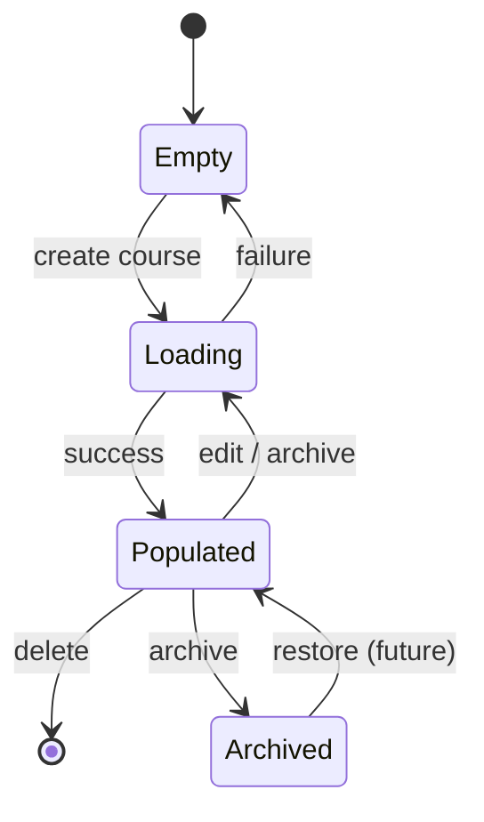
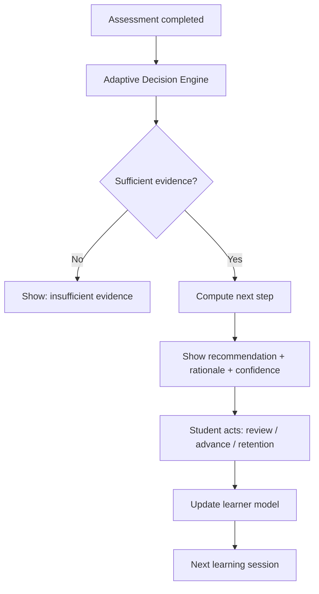

# INTERACTION_FLOWS.md

# AQVERA — Interaction Flows

Status: DECIDED (flow specifications); future functionality specified as intended UX without implementation.

Flow status labels:
- `Implemented` — code exists and verified.
- `Planned` — intended UX specified, not built.
- `Not Designed` — no flow specified yet.

---

## 1. Create course

```
[Student] -- "Create course" --> [Dialog opens]
[Student] -- fills title (+ optional fields) --> [Form]
[Student] -- submit --> [Validate title required]
[Validate] -- pass --> [POST /courses API]
[POST] -- 201 --> [Add course to list, close dialog, success]
[POST] -- error --> [Error banner, remain in dialog]
[Validate] -- fail --> [Inline field error, remain in dialog]
[Student] -- cancel --> [Close dialog, no change]
```

- **Status:** Partially Implemented (frontend dialog + API calls present; backend required).
- **UI states:** Empty, Loading, Validation error, Success, Populated.
- **Accessibility:** Dialog role="dialog", aria-modal, focus trap, escape closes, labels on fields.

---

## 2. Edit course

```
[Student] -- "Edit" --> [Edit dialog prefilled with course data]
[Student] -- edits fields --> [Form]
[Student] -- "Save changes" --> [PUT /courses/{id}]
[PUT] -- 200 --> [Update list row, close dialog]
[PUT] -- error --> [Error banner]
[Student] -- cancel --> [Close dialog, no change]
```

- **Status:** Partially Implemented.
- **UI states:** Loading, Validation error, Success, Populated.

---

## 3. Archive course

```
[Student] -- "Archive" --> [PATCH /courses/{id}/archive]
[PATCH] -- 200 --> [Row marked "Archived", removed from active list]
[PATCH] -- error --> [Error banner]
[Student] -- "Show archived" --> [List includes archived courses]
```

- **Status:** Partially Implemented.
- **UI states:** Populated, Empty (no archived).

---

## 4. Delete course

```
[Student] -- "Delete" --> [Destructive confirmation dialog]
[Student] -- confirm --> [DELETE /courses/{id}]
[DELETE] -- 200 --> [Course removed from list]
[DELETE] -- error --> [Error banner]
[Student] -- cancel --> [Dialog closes, no change]
```

- **Status:** Partially Implemented (uses browser `confirm`; should be replaced with accessible dialog).
- **UI states:** Destructive confirmation, Populated, Empty.
- **Note:** Confirmation must be a modal dialog, not `window.confirm`, for accessibility.

---

## 5. Material upload

```
[Student] -- select file(s) --> [Validate type + size client-side]
[Validate] -- pass --> [Initiate upload job]
[Upload] -- progress --> [Processing status bar (0-100%)]
[Upload] -- complete --> [Extraction complete → course structure proposed]
[Upload] -- fail --> [Explicit failure reason + retry]
[Validate] -- fail --> [Inline error: unsupported type / too large]
```

- **Status:** Planned.
- **UI states:** Empty, Loading (with progress), Partial data, Success, Server error.
- **Note:** Never show fake progress; progress must reflect actual job status.

---

## 6. Upload validation

```
[File selected] -- check extension --> [Allowed?]
[Allowed?] -- no --> [Error: unsupported file type]
[Allowed?] -- yes --> [check size <= limit]
[Size] -- over --> [Error: file too large]
[Size] -- ok --> [check malware scan (future)]
[Scan] -- clean --> [Start upload]
[Scan] -- infected --> [Error: file rejected]
```

- **Status:** Planned.
- **UI states:** Validation error, Loading.

---

## 7. Processing and extraction states

```
[Upload complete] -- job queued --> [Queued state]
[Queued] -- worker picks up --> [Processing state + progress]
[Processing] -- extraction done --> [Completed → propose course structure]
[Processing] -- extraction fail --> [Failed → reason + retry]
```

- **Status:** Planned.
- **UI states:** Loading, Partial data, Success, Server error.

---

## 8. Review of extracted material

```
[Processing complete] -- [Present proposed course structure]
[Student] -- review modules/topics/objectives --> [Edit]
[Student] -- save edits --> [PUT course structure]
[Student] -- publish --> [Publish to workspace]
```

- **Status:** Planned.
- **UI states:** Populated, Loading, Validation error, Success.

---

## 9. Navigation from course to topic

```
[Course workspace] -- select module/topic --> [Course Learning Interface]
[Interface] -- show current objective --> [Lesson content]
[Student] -- next topic --> [Update context, new lesson]
```

- **Status:** Planned.

---

## 10. Learning session

```
[Open lesson] -- [Render text, visualizations, activities]
[Student] -- interact --> [Activity may produce evidence]
[Student] -- open assessment --> [Assessment Interface]
```

- **Status:** Planned.

---

## 11. Assessment attempt

```
[Open assessment] -- [Present questions, no answers before completion]
[Student] -- answer questions --> [Form]
[Student] -- submit --> [Validate completeness]
[Validate] -- pass --> [Evaluate answers]
[Evaluate] -- deterministic (math/numeric) / criteria (subjective) --> [Feedback]
[Feedback] -- [Record evidence, update learner model]
[Validate] -- fail --> [Inline field errors, remain]
```

- **Status:** Planned.
- **UI states:** Loading, Populated, Validation error, Success, Error.

---

## 12. Submission and feedback

```
[Assessment submitted] -- [Show feedback: understood, weak, rationale, next steps]
[Student] -- view feedback --> [Evidence sufficiency statement]
[Student] -- act on recommendation --> [Next activity]
```

- **Status:** Planned.
- **UI states:** Populated, Empty (insufficient evidence).

---

## 13. Error recovery

| Error type | User signal | Recovery |
|------------|-------------|----------|
| Network failure | Error banner, offline indicator | Retry when online |
| Server error (5xx) | Error banner | Retry, or contact support |
| Validation error | Inline field error + error summary | Correct and resubmit |
| Upload failure | Processing failed state | Retry or replace file |
| AI provider failure | Fallback/degraded message | Try again or continue offline |
| Unauthorized | Redirect to sign-in | Sign in |
| Not found | "Course not found" + return link | Return to library |

- **Status:** Partially specified (implemented for courses; planned elsewhere).
- **Rule:** Never communicate state by color alone; always pair with text and/or icon.

## Diagrams

### Course CRUD state machine



### Adaptive recommendation flow


